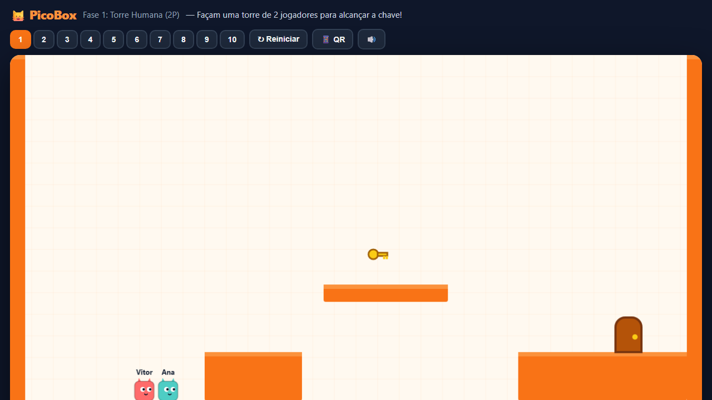
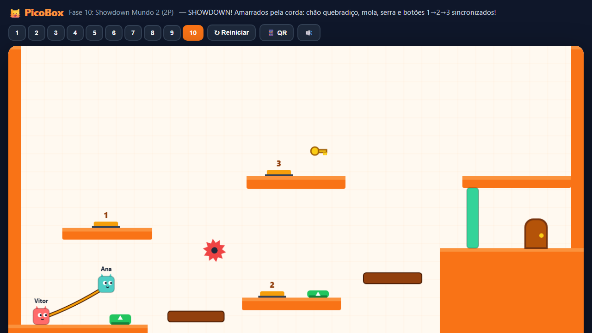

# 🐱 PicoBox

A **60 FPS cooperative 2D platformer** inspired by *Pico Park*, built in **Rust** (`axum` + WebSockets) for local network couch play! Stream the TV screen to your living room TV and let up to 8 players join using their **phones as multi-touch gamepads**, **USB/Bluetooth joysticks**, or **keyboard**.





## 🎮 Features

- **60 Hz Authoritative Rust Physics Engine** — Solid player-on-player head stacking with horizontal ride-along carry, push-chain heavy blocks, coyote time, and jump buffering.
- **Dynamically Adapts to Player Count (`1P`–`8P`)** — Tower heights, push-block weights, elevator capacity/width, and sequence timers automatically scale to your group size.
- **Mix Any Controllers Simultaneously:**
  - 📱 **Phones (iPhone / Android):** Scan the QR code on the TV for a zero-install landscape touch gamepad.
  - 🎮 **Joysticks / Gamepads:** Plug-and-play Xbox, PlayStation, or Moonlight TV controllers via the Web Gamepad API.
  - ⌨️ **Keyboard:** `←`/`→` + `Space`/`↑` (and `WASD` for a second player) on both the TV and controller pages.

## 🗺️ Worlds & Levels (10 Handcrafted Co-op Levels, PT-BR)

### World 1 — Core Co-op Mechanics
1. **Fase 1: Torre Humana** — Stack on teammates' heads to reach the high key.
2. **Fase 2: A Ponte** — Pressure buttons that hold solid bridges over spike pits.
3. **Fase 3: Empurra Junto!** — Giant heavy blocks with Pico Park push-chain physics.
4. **Fase 4: Elevador** — Teamwork elevator that rises only when everyone stands on it together.
5. **Fase 5: Showdown Mundo 1** — Combines stacking, buttons, heavy blocks, and elevators.

### World 2 — Chaos & Communication
6. **Fase 6: A Corda** — Elastic rope tethering all players together over spike gaps.
7. **Fase 7: Ordem Sincronizada** — Timed sequence relay (`1 → 2 → 3 → 4`, scaling up to 6 buttons for 6P+).
8. **Fase 8: Chão Quebradiço** — Split upper/lower crumbling platforms with cross-lane switches.
9. **Fase 9: Molas & Lâminas** — Spring-pad launches, patrolling buzzsaws, and timed hatches.
10. **Fase 10: Showdown Mundo 2** — Rope + crumbling bridges + springs + patrolling saw + timed sequence relay!

## 🚀 Quick Start

```bash
cargo run --release
```

1. Open the **TV Screen**: `http://localhost:3103/tv`
2. Scan the **QR Code** on phones (or open `http://<your-lan-ip>:3103/` on any laptop/phone), or just press a button on your joystick / keyboard!

*(Configure the port with the `PORT` environment variable—defaults to `3103`.)*

## License

MIT
